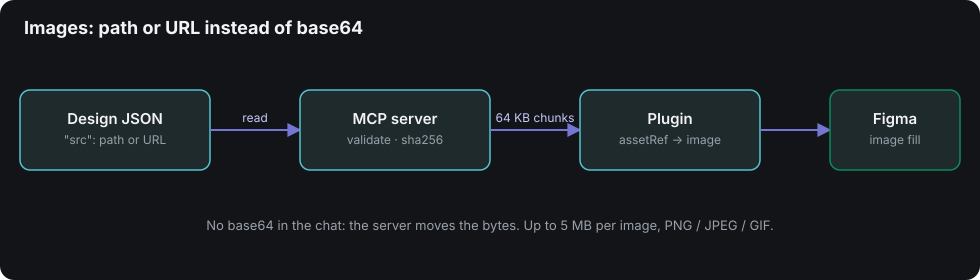

# Design schema 1.0 reference

This page is for AI agents and developers who write the JSON that `figma_import_design_schema` turns into editable Figma layers. An agent can get the same reference at runtime with the MCP tool **`figma_get_schema`**. It returns this guide, the formal JSON Schema (`schema/design-spec-1.0.schema.json`) and a complete example.

## Document

```json
{ "schemaVersion": "1.0", "name": "Pricing", "pages": [{ "id": "p1", "name": "Pricing", "children": [ /* layers */ ] }] }
```

Every layer needs `id` (unique), `name`, `type`, `width` and `height`. `x` and `y` are relative to the parent.

Colours are `#RRGGBB`. The importer also accepts `#RGB`, `#RRGGBBAA` and `rgba(r,g,b,a)`; the alpha becomes `opacity`.

## Layers

| `type` | Main properties |
|---|---|
| `frame` | `paints` or `fill`, `layout` (Auto Layout), `layoutGrids`, `clipsContent`, `radius` or `cornerRadii`, `children` |
| `group` | `children`. Children `x`/`y` are relative to the group's `x`/`y`. A real Figma group is created, and Figma sizes it from its children. Groups cannot have fills; use a frame for that. |
| `component` | Like `frame`, but becomes a Figma component |
| `instance` | `componentRef`: the id of a component declared earlier in the document |
| `text` | See [Text](#text) |
| `rectangle` | `paints`/`fill`, `radius`/`cornerRadii`, `stroke`, `strokeWidth`, `strokeAlign` |
| `ellipse` | `paints`/`fill`, `stroke` |
| `line` | `stroke`, `strokeWidth` |
| `vector` | `path` (SVG path data), `fill` |
| `image` | See [Images](#images) |

## Text

| Property | Values |
|---|---|
| `text` | the characters (alias: `content`) |
| `fontFamily`, `fontSize` | e.g. `"Inter Tight"`, `24` |
| `fontWeight` | `100`–`900`, or a name such as `"Bold"` or `"ExtraBold"` |
| `fontStyle` | an exact Figma style, e.g. `"Bold Italic"`; it wins over `fontWeight` |
| `align` | `LEFT` · `CENTER` · `RIGHT` · `JUSTIFIED`. Aliases: `textAlign`, `textAlignHorizontal`, lowercase values. |
| `textAlignVertical` | `TOP` · `CENTER` · `BOTTOM` |
| `textAutoResize` | `NONE` · `HEIGHT` (fixed width, grows down) · `WIDTH_AND_HEIGHT` (no wrapping) · `TRUNCATE` |
| `lineHeight` | pixels, or `{unit:"PERCENT", value:150}` |
| `letterSpacing` | `{unit:"PIXELS"\|"PERCENT", value}`, or a number (pixels) |
| `color`, `textDecoration`, `textCase`, `paragraphSpacing` | as in Figma |

**Fonts.** The plugin picks the installed style closest to `fontWeight`. For example, 800 matches `ExtraBold` or `Extra Bold`, whichever the family uses. If a family or style is not installed, it falls back to Inter. Every fallback is listed in the job result `warnings`; it is never silent.

## Paints

`paints` is a stack of up to 8 paints, bottom first. The older `fill: "#hex"` still works, and `fills` is accepted as an alias of `paints`.

```jsonc
{ "type": "solid", "color": "#0B8A60", "opacity": 1 }

// Linear gradient: any of these four forms
{ "type": "linear-gradient", "gradient": { "direction": "horizontal", "stops": [{ "position": 0, "color": "#6366F1" }, { "position": 1, "color": "#EC4899" }] } }
{ "type": "linear-gradient", "gradient": { "angle": 135, "stops": [ /* … */ ] } }          // CSS angle: 0 = up, 90 = right, 180 = down
{ "type": "linear-gradient", "gradient": { "start": {"x":0,"y":0}, "end": {"x":1,"y":1}, "stops": [ /* … */ ] } }  // Penpot style; "handles":[start,end] also works
{ "type": "linear-gradient", "gradient": { "transform": [[1,0,0],[0,1,0]], "stops": [ /* … */ ] } }  // raw Figma gradientTransform

{ "type": "radial-gradient", "gradient": { "transform": [[1,0,0],[0,1,0]], "stops": [ /* … */ ] } }   // also angular-gradient, diamond-gradient
{ "type": "image", "src": "/Users/me/hero.jpg", "scaleMode": "FILL" }
```

Gradient stops take `position` (0–1; `offset` and percentages are also accepted), `color` and an optional `opacity`. When `direction` is omitted, `horizontal` is used.

## Effects

```json
[{ "type": "drop-shadow", "color": "#000000", "opacity": 0.15, "offsetX": 0, "offsetY": 8, "blur": 24, "spread": 0 },
 { "type": "inner-shadow", "color": "#000000", "opacity": 0.1, "offsetX": 0, "offsetY": 1, "blur": 2 },
 { "type": "layer-blur", "blur": 8 }, { "type": "background-blur", "blur": 20 }]
```

## Corner radius

- **Same radius on every corner:** `"radius": 12`.
- **Different radius per corner:** `"cornerRadii": { "topLeft": 12, "topRight": 12, "bottomRight": 0, "bottomLeft": 0 }`.

The importer also accepts these per-corner forms:

- `"radius": [12, 12, 0, 0]` (top-left, top-right, bottom-right, bottom-left);
- `"radius": { "topLeft": 12, … }`;
- `topLeftRadius` / `topRightRadius` / `bottomRightRadius` / `bottomLeftRadius`.

## Images



An image layer, or an image paint, needs one source:

| Source | When to use it |
|---|---|
| `"src": "/absolute/path.png"` or `"src": "https://…"` | **Best for agents.** The MCP server reads the file or downloads the URL, uploads it in checksum-verified chunks, and replaces `src` with an `assetRef`. Up to 5 MB per image. `url` and `filePath` work as aliases. |
| `"assetRef": "<sha256>"` | An image you already uploaded with **`figma_upload_image`** (`filePath`, `url` or `base64`). Uploads last until the plugin restarts. |
| `"data": "<base64>", "mimeType": "image/png"` | Small inline images, up to 256 KB. Larger base64 sent through MCP is uploaded automatically. |

`scaleMode` is `FILL` by default (the image covers the layer). It can also be `FIT`, `CROP` (with `imageTransform`) or `TILE` (with `scalingFactor`). PNG, JPEG and GIF are supported, and the type is detected from the bytes.

## Pages

By default, every import creates a new page. `figma_import_design_schema` also accepts:

- `targetPageId`: draw into an existing page instead;
- `replacePage: true`: replace the page that has the same name. The new page is built first and swapped in only after it succeeds.

`figma_list_pages` lists page ids. `figma_delete_page` removes a page; it refuses to delete the last page, and Figma's undo can restore it.

## Result

`figma_get_job_result` for an import returns:

```json
{ "created": 1, "nodes": 14, "pages": [{ "id": "12:3", "name": "Pricing" }], "warnings": ["Font \"Inter Tight ExtraBold\" is not installed; used \"Inter Bold\"."], "message": "Editable Figma layers were inserted with 1 warning(s)." }
```

## Error messages

Validation errors name the exact field. For example:

- `pages[0].children[0].paints[1].gradient.stops[0].color: missing required property`
- `Unsupported paint type "wavy". Use one of: solid, linear-gradient, …`

Other tools' spellings (Figma API, Penpot, CSS) are converted automatically. The tool result's `migrated` list shows each conversion.

## Limits

| Limit | Value |
|---|---|
| JSON size | 512 KB |
| Layers | 2,000 |
| Nesting depth | 16 |
| Inline image | 256 KB |
| Uploaded image | 5 MB, at most 4096 px per side |
